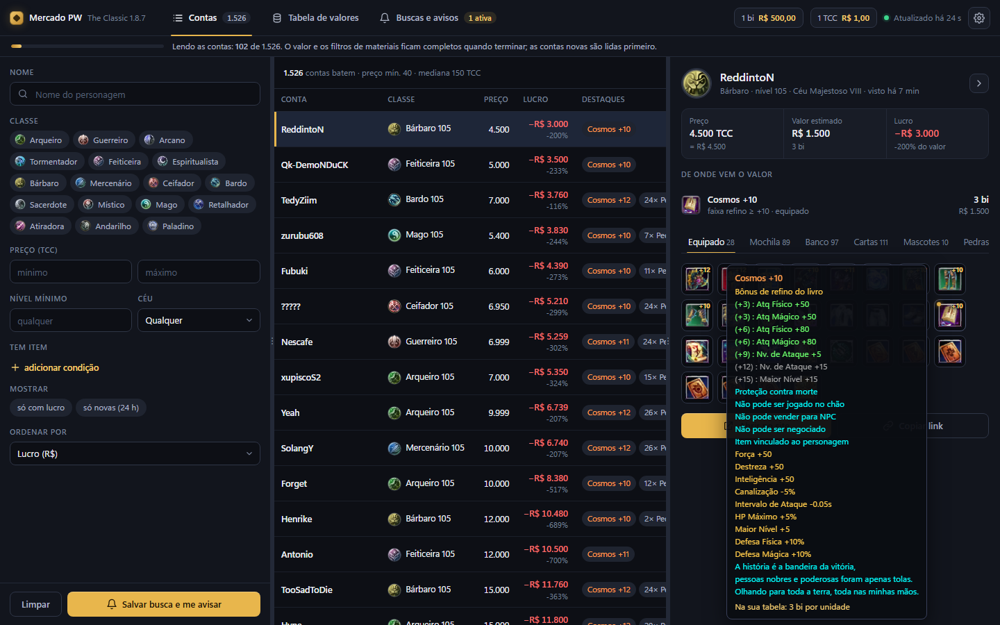
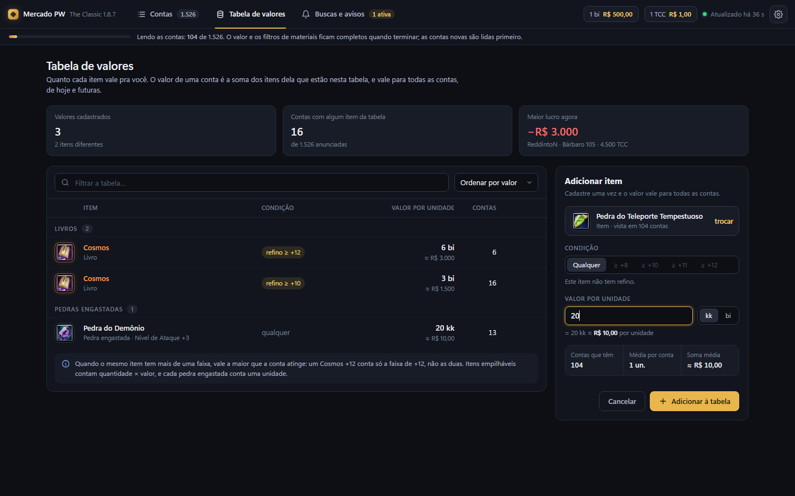
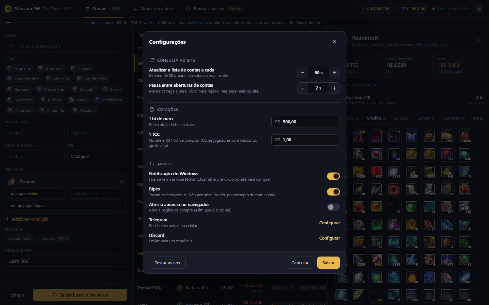

# Mercado PW

Programa para PC que acompanha o [Marketplace The Classic](https://marketplace.theclassic.games/pw187) do PW 1.8.7. Ele faz três coisas:

- lista todas as contas anunciadas e permite filtrar por classe, preço, nível, Céu e itens;
- calcula quanto cada conta vale pela **sua** tabela de valores e ordena pelas maiores barganhas;
- avisa na hora quando aparece uma conta nova, ou que baixou de preço, que bate com uma busca salva.



## Como abrir

Você precisa de:
- **Python 3.11 ou mais novo.** Não há pacotes para instalar.
- **Microsoft Edge.** Já vem no Windows 10 e 11.

Para abrir, dê dois cliques em **`Mercado PW.bat`**. O programa abre numa janela própria, sem abas nem barra de endereço, e **fechar a janela encerra o programa**. Um segundo clique com ele já aberto apenas abre outra janela.

## Primeira vez

1. **Carga inicial.** Assim que abre, o programa baixa a lista de anúncios e começa a ler, em segundo plano, os itens de cada conta. Cada conta é lida uma vez só. Com cerca de 1.500 anúncios, a carga inicial leva por volta de 2 h com a pausa padrão de 2 s (menos se você diminuir a pausa), num ritmo que não sobrecarrega o site. O que já foi lido fica salvo: se fechar no meio, ele continua de onde parou. A barra no topo mostra o progresso.
2. **O que é lido primeiro:**
   - contas novas ou que baixaram de preço;
   - contas que têm itens da sua tabela de valores (o programa descobre quais são pela busca do próprio site, em menos de 1 s);
   - o restante, das mais baratas para as mais caras.
3. **Cadastre seus valores.** Na aba **Tabela de valores**, digite "cosmos", escolha a faixa de refino e informe o valor em kk ou bi.
4. **Monte uma busca.** Na aba **Contas**, monte os filtros e clique em **Salvar busca e me avisar**.

## O que tem em cada aba

**Contas**
- **Filtros:** nome, classes, faixa de preço (TCC), nível mínimo, Céu e condições de item (refino mínimo, quantidade mínima e onde o item está: equipado, mochila, banco, cartas, engastado, mascotes).
- **Lista:** ordenada por lucro, em R$ ou %, com a marca **NOVA** para contas das últimas 24 h. Contas que ainda não foram lidas, mas que a busca do site diz terem o item, aparecem como **A CONFIRMAR**.
- **Detalhes:** mostram de onde vem o valor, os itens por aba com o tooltip do jogo ao passar o mouse e o botão "Abrir no site". Clicar num item abre um balão para dar valor a ele ali mesmo.
- **Painéis:** as divisórias ⋮ podem ser arrastadas, e o botão ⟩ recolhe os detalhes (a lista ganha as colunas Céu e Valor). Use ↑ e ↓ para percorrer a lista.

**Tabela de valores**
- **É global:** cada item é cadastrado uma vez e vale para todas as contas, as de hoje e as futuras.
- **Sugestões:** vêm do catálogo do site (disponível desde o primeiro minuto) e de tudo o que já foi visto nas contas: materiais, pedras e cartas. Um item que ainda não apareceu pode ser cadastrado pelo nome; o valor passa a contar quando o item surgir.



**Buscas e avisos**
- Buscas salvas com "me avisar", lucro mínimo (R$ ou %) e quantas contas batem agora.
- Histórico dos avisos. Clicar num aviso abre a conta.

**⚙ Configurações**

| Opção | O que faz |
|---|---|
| Intervalo de consulta | De quanto em quanto tempo a lista é consultada. Padrão 60 s, mínimo 30 s. |
| Pausa entre contas | Intervalo entre a leitura de uma conta e a próxima. |
| Cotações | Quanto vale 1 bi e 1 TCC em reais. Padrão: 1 bi = R$ 500 e 1 TCC = R$ 1. |
| Avisos | Notificação do Windows (clicar abre o anúncio para comprar), bipes (tocam mesmo com o "Não perturbe" ligado, por exemplo durante o jogo), abrir no navegador, Telegram e Discord. O botão "Testar avisos" confere se estão funcionando. |



## Como o valor é calculado

- Cada linha da tabela vale **por unidade**, em kk (1 bi = 1.000 kk).
- **Faixas de refino:** com várias faixas do mesmo item, vale a maior que o item atinge. Com Cosmos +10 = 3 bi e +12 = 6 bi, um Cosmos +12 conta 6 bi.
- **Quantidades:** itens empilháveis contam quantidade × valor, e cada pedra engastada conta uma unidade.
- **O que fica de fora:** o códice (coleção de visuais) e a lista de recompra. O ouro que o personagem carrega também não entra, porque os vendedores costumam retirá-lo.
- **Contas:**
  - valor em R$ = soma dos itens em kk ÷ 1.000 × R$ por bi;
  - preço em R$ = TCC × R$ por TCC;
  - lucro = valor − preço;
  - % = lucro ÷ valor.
- **Contas sem nenhum item da tabela** ficam sem lucro ("—").

## Arquivos

| Caminho | O que é |
|---|---|
| `Mercado PW.bat` | Abre o programa. |
| `mercado/` | Código: leitura do site, banco, cálculo, coletor, avisos, servidor local e interface (`mercado/ui`). |
| `mercado.db` | Seus dados: contas lidas, tabela de valores, buscas e configurações. Fica só no seu PC. |
| `mercado.log` | Registro do que o programa fez, útil se algo der errado. |
| `.janela/` | Perfil separado do Edge usado pela janela do programa. |
| `docs/` | Desenho do programa e telas aprovadas. |
| `helper.py`, `filtros.toml`, `iniciar.bat` | A primeira versão, de linha de comando. Ainda funciona, mas o programa novo faz tudo o que ela fazia. |

## Para desenvolvedores

```
py -m unittest discover -s tests -t .     # testes (usam páginas reais salvas em tests/paginas)
py -m mercado --sem-janela --porta 8765   # só o servidor, para abrir no navegador
```

- **Segurança:** o servidor local só aceita conexões do próprio PC. Cada chamada da interface leva um token gerado a cada execução.
- **Ritmo:** o programa só lê páginas públicas do marketplace. Mantenha o intervalo e a pausa em valores razoáveis.
- **Se o site mudar:** se o layout do marketplace mudar, a leitura pode falhar. Nesse caso aparece um aviso no topo da janela e nada do que já foi guardado é apagado.
